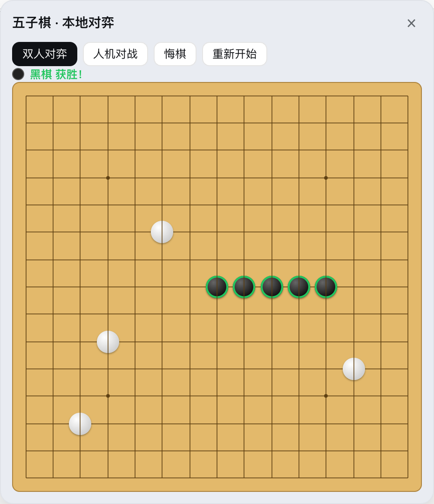
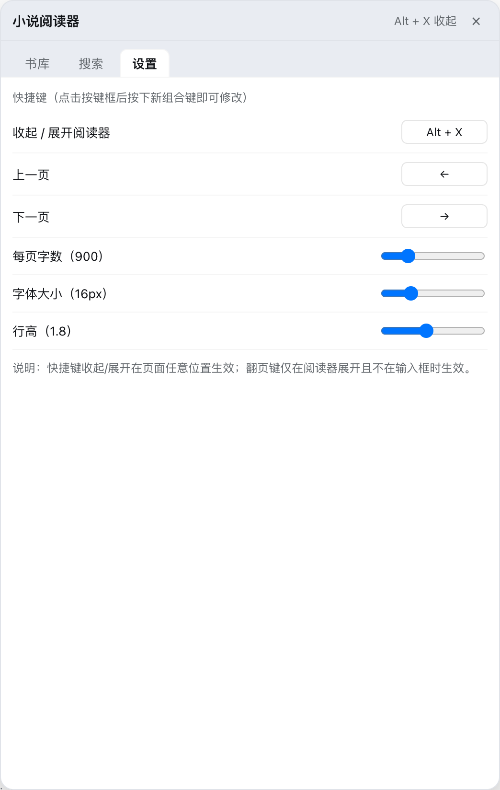

# deekseek-harness-plugin-king

面向 DSH（deepseek harness）Web GUI 的插件仓库。两个插件都注册在会话头部操作区（`conversation.session.header.actions`），随点随用，全程不消耗 LLM token。

## 插件一览

### 1. dsh-gomoku-local —— 五子棋 · 本地对弈

在会话头部放一个「五子棋」按钮，点开即玩，**纯浏览器本地运行**：不调用模型、不联网、零 token 消耗。

- **双人对弈**：同屏轮流落子，黑白交替
- **人机对战**：内置启发式 AI（按连子形态打分，攻守兼顾），你执黑先行
- **悔棋 / 重新开始**：人机模式下一步悔棋自动回退双方各一手
- **对局反馈**：最后一手高亮、五连获胜棋子描边、状态栏实时提示轮到谁



代码：[`dsh-gomoku-local/`](dsh-gomoku-local/)（host 侧为空插件，游戏逻辑全部在 `lib/client.js`）。

### 2. dsh-novel-reader —— 小说阅读器

会话头部的「阅读」按钮，弹出一个完整的分页阅读面板：搜索、下载、书库、阅读、设置五个视图，**不涉及任何 LLM 调用**。

- **在线搜索**：双书源并发查询
  - 整本下载源（txt80）：搜索结果可直接**一键下载全文**入库（GBK 自动转 UTF-8）
  - 元信息源（云阅读 API）：书目更全，可「存为待读」占位
- **本地导入 / 导出**：支持导入 UTF-8 编码的 `.txt`；库中任意书籍可导出为 TXT
- **书库持久化**：书籍正文存于浏览器 IndexedDB，阅读进度与设置存于 localStorage，关掉页面也不丢
- **分页阅读**：按页翻阅，显示「当前页 / 总页数」，自动记忆每本书的阅读位置
- **全自定义快捷键**：收起/展开（默认 `Alt+X`，全局生效）、上一页 / 下一页（默认 `←` / `→`），点击按键框按下新组合即可改绑
- **排版可调**：每页字数（300–3000）、字号（12–28px）、行高（1.2–2.6）滑杆实时生效

| 书库 | 阅读 |
| --- | --- |
|  |  |

| 搜索 | 设置 |
| --- | --- |
|  |  |

代码：[`dsh-novel-reader/`](dsh-novel-reader/)。host 侧（`lib/index.js`）在同源 HTTP 路由上代理搜索与抓取（浏览器无 CORS 困扰，且校验 `Origin` 仅允许同源调用）；浏览器侧（`lib/client.js`）渲染全部阅读 UI。

## 安装

两个插件都是标准的 dsh bundle 包（含 `cordis.patch.yml`）。以本地 link 方式装进 web profile 即可，例如在 profile 的 `package.json` 中：

```json
{
  "dependencies": {
    "dsh-gomoku-local": "link:/path/to/deekseek-harness-plugin-king/dsh-gomoku-local",
    "dsh-novel-reader": "link:/path/to/deekseek-harness-plugin-king/dsh-novel-reader"
  },
  "dsh": {
    "profile": {
      "bundles": ["dsh-gomoku-local", "dsh-novel-reader"]
    }
  }
}
```

安装后重启 dsh web，进入任意会话即可在头部看到「五子棋」「阅读」两个按钮。

## 截图说明

`screenshots/` 下的图片为实际运行截图（headless Chrome 驱动本机 dsh web GUI 拍摄，2x 缩放）。
